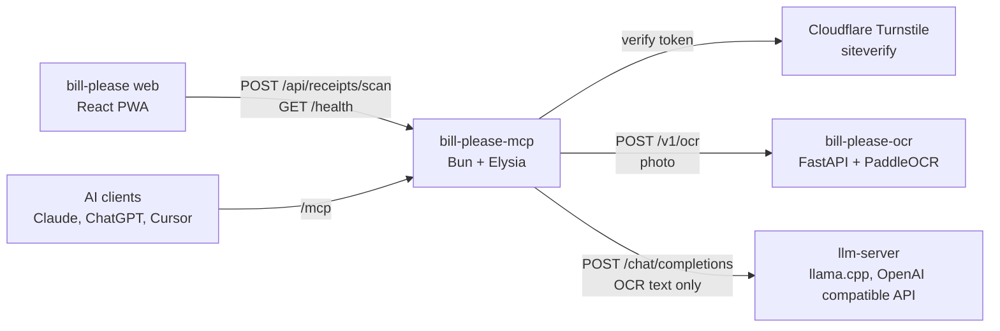

<h1 align="center">
  <p align="center">Bill-Please MCP</p>
</h1>

Receipt scanning backend for [Bill Please](https://github.com/chatreejs/bill-please).
One server exposes the same receipt scanner in two ways:

| Endpoint | Protocol | Used by |
|---|---|---|
| `POST /api/receipts/scan` | REST, `multipart/form-data` with `image` and `cf-turnstile-response` fields | bill-please web |
| `/mcp` | [MCP](https://modelcontextprotocol.io) Streamable HTTP, stateless | AI clients such as Claude, ChatGPT and Cursor |
| `GET /health` | REST | The Docker healthcheck, and bill-please web to enable "Add from bill" |

It runs on [Bun](https://bun.sh) with [ElysiaJS](https://elysiajs.com), the official
[MCP TypeScript SDK](https://github.com/modelcontextprotocol/typescript-sdk) and zod.

## Architecture



A scan from the web goes through these steps:

1. bill-please web resizes the photo to a JPEG of at most 1600 px and uploads it
   with a Turnstile token.
2. bill-please-mcp checks the Turnstile token with Cloudflare. `/mcp` skips this
   step and relies on the rate limit.
3. bill-please-mcp sends the photo to bill-please-ocr and gets back text lines.
4. bill-please-mcp sends only the OCR text to llm-server, which returns the items
   and the receipt rates.
5. bill-please-mcp checks the items against the printed total and returns them.

## Response contract

Both endpoints return the same JSON, which matches `IReceiptScanResult` in bill-please web.
MCP returns it as `structuredContent`.

```json
{
  "items": [
    { "name": "Pad Thai", "quantity": 2, "price": 120, "servicePercentage": 10, "vatPercentage": 7, "category": "food" },
    { "name": "Member Discount", "quantity": 1, "price": -200 }
  ]
}
```

`price` is the unit price before service charge and VAT. `name` has OCR errors
fixed, and `category` is one of `food`, `drink`, `alcohol`, `dessert` or `other`.
Discounts have no category. The schema is in
`src/schemas/receipt.ts`, and the server checks every scanner result against it.

## Development

```bash
cp .env.example .env
bun install
bun dev            # http://localhost:3001
bun test
bun run check-types
```

Try the REST endpoint:

```bash
curl -F image=@receipt.jpg http://localhost:3001/api/receipts/scan
```

To try the MCP endpoint, run the MCP Inspector with `bun run inspect`. Choose the
Streamable HTTP transport and the URL `http://localhost:3001/mcp`.

## Scanner

The scanner sends the photo to [bill-please-ocr](https://github.com/chatreejs/bill-please-ocr)
at `OCR_URL`, then sends only the OCR text to an OpenAI compatible LLM at `LLM_URL`.
In the cluster that LLM is the shared llama.cpp `llm-server`. A receipt with no
readable text gets a 422 without an LLM call.

To run it locally, start bill-please-ocr on port 8000 and port-forward the LLM to
port 8080:

```bash
zsh -c 'trap "kill 0" INT TERM EXIT
kubectl -n llm-server port-forward svc/llm-server 8080:8080 &
(cd ../bill-please-ocr && PORT=8000 uv run python -m receipt_ocr) &
bun dev'
```

To replace the scanner, implement the `ReceiptScanner` interface in
`src/scanners/types.ts` and return it from `createScanner` in `src/scanners/index.ts`.

## Turnstile

`POST /api/receipts/scan` can require a Cloudflare Turnstile token, sent by
bill-please web as the `cf-turnstile-response` form field. Set
`TURNSTILE_SECRET_KEY` to the widget's secret key to turn the check on, and
`TURNSTILE_HOSTNAMES` (for example `bill-please.chatree.dev`) to accept tokens
only from those sites. Without a secret key the check is off. The server answers
403 for a missing or rejected token and 503 when Cloudflare can't be reached.

## Logging

Logs are JSON lines, one object per record, for Loki or any log collector:

```json
{"time":"2026-10-30T15:34:11.908Z","level":"info","service":"bill-please-mcp","logger":"http.access","requestId":"982c4a53","msg":"GET /health 200 3ms","http":{"method":"GET","path":"/health","status":200,"durationMs":3},"clientIp":"::1","userAgent":"Mozilla/5.0"}
```

The logger writes an error as an `error` field with `type`, `message`, `stack` and `cause`.

`LOG_LEVEL` sets the level to `TRACE`, `DEBUG`, `INFO`, `WARN`, `ERROR` or `OFF`.
The default is `INFO`. Every response has an `X-Request-Id` header. Send your own
`X-Request-Id` to find the same request in the logs of several services. The
scanner passes it on to bill-please-ocr.

## Docker

The Jenkins pipeline in `ci/Jenkinsfile` builds and deploys the image. It runs the
tests, scans with SonarQube, builds the image, scans it with Trivy, pushes it and
triggers the GitOps deploy. To run the image by hand:

```bash
docker build -t bill-please-mcp .
docker run -d -p 3001:3001 --env-file .env bill-please-mcp
```

Behind a reverse proxy, set `TRUST_PROXY=true` so rate limiting and the access log use
the client IP from `CF-Connecting-IP`, or else the first `X-Forwarded-For` entry.

## MCP tools

| Tool | Input | Output |
|---|---|---|
| `scan_receipt` | `imageBase64`, `mimeType` | `{ items: ReceiptItem[] }` |

## Security notes

- `/mcp` has no authentication yet. Add an API key or OAuth before you expose a
  paid model.
- Each process keeps its own in-memory rate limit. Use a shared store if you run
  several replicas.

Report vulnerabilities privately as described in [SECURITY.md](./SECURITY.md).

## Can I contribute?

Yes.

- [Star the repo](https://github.com/chatreejs/bill-please-mcp).
- [Report a bug](https://github.com/chatreejs/bill-please-mcp/issues) if something doesn't work.
- [Suggest a feature](https://github.com/chatreejs/bill-please-mcp/issues).
- [Join our Discord server](https://discord.gg/HdknCHG7Rr) for less formal discussion.

Please read the [contributing guidelines](./CONTRIBUTING.md) and follow the
[Code of Conduct](./CODE_OF_CONDUCT.md).

## License

The project uses the [AGPL-3.0 License](./LICENSE).
